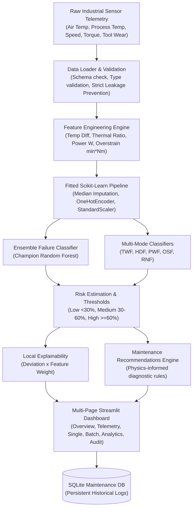
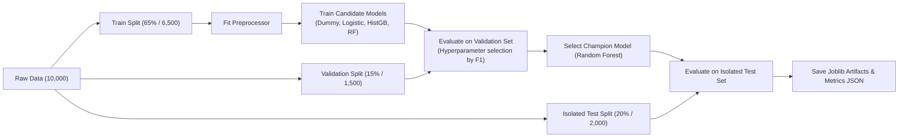

# AI-Based Predictive Maintenance and Machine Failure Detection System

An enterprise-ready, end-to-end industrial machine learning platform that analyzes physical machine telemetry, identifies anomalous operating envelopes, quantifies failure risk probabilities, pinpoints specific failure categories (Tool Wear, Heat Dissipation, Power Failure, Overstrain, Random Anomaly), and prescribes actionable maintenance interventions through an interactive Streamlit dashboard.

---

## 📑 Table of Contents

1. [Project Overview](#-project-overview)
2. [Problem Statement & Objectives](#-problem-statement--objectives)
3. [System Architecture](#-system-architecture)
4. [Dataset & Physical Schema](#-dataset--physical-schema)
5. [Machine Learning Workflow](#-machine-learning-workflow)
6. [Model Evaluation & Benchmarking](#-model-evaluation--benchmarking)
7. [Explainability & Maintenance Recommendations](#-explainability--maintenance-recommendations)
8. [Installation & Setup Guide (Windows PowerShell)](#-installation--setup-guide-windows-powershell)
9. [Execution & Operational Commands](#-execution--operational-commands)
10. [Dashboard Walkthrough (7 Integrated Pages)](#-dashboard-walkthrough-7-integrated-pages)
11. [Example Inputs & Structured Predictions](#-example-inputs--structured-predictions)
12. [Repository & Directory Structure](#-repository--directory-structure)
13. [Limitations & Industrial Transition Roadmap](#-limitations--industrial-transition-roadmap)

---

## 🎯 Project Overview

In industrial manufacturing, unexpected machine breakdowns lead to substantial financial losses, equipment damage, and hazardous workplace conditions. Traditional maintenance strategies rely on:
- **Reactive maintenance ("run-to-failure")**: Repairing machines only after catastrophic breakdown occurs.
- **Calendar-based maintenance**: Servicing equipment at arbitrary fixed intervals regardless of actual wear and tear.

This project delivers **Condition-Based Predictive Maintenance (PdM)**. By analyzing multi-sensor telemetry—ambient and process temperatures, spindle rotational velocities, applied torque, and cumulative cutting tool wear—the system estimates operational failure probabilities in real-time, alerts plant technicians before failure cascades, and recommends targeted maintenance tasks.

---

## 📌 Problem Statement & Objectives

The application enables maintenance managers, reliability engineers, and operators to answer key operational questions:

| Operational Question | System Answer & Mechanism |
|---|---|
| **Is the machine operating normally?** | Binary status classification (`Normal` vs. `Failure Risk`) based on decision threshold. |
| **Is the machine at risk of failure?** | 3-tier risk classification: Low (<30%), Medium (30–60%), High (≥60%). |
| **What is the failure probability?** | Model-estimated risk score calibrated across multi-sensor inputs. |
| **What type of failure might occur?** | Multi-model screening for 5 failure modes: Tool Wear (TWF), Heat Dissipation (HDF), Power (PWF), Overstrain (OSF), and Random (RNF). |
| **Which sensor readings contributed most?** | Local feature contribution analysis measuring deviation from normal baseline weighted by feature importance. |
| **What maintenance action is needed?** | Rule-based, physics-informed recommendations targeting lubrication, cooling, tooling, or electrical drives. |
| **How has machine health changed over time?** | Persistent audit logging in SQLite tracking every inference with searchable asset history. |

> **⚠️ Engineering Note**: This system performs **condition-based failure classification and risk estimation** from current sensor telemetry. It is **not** a Remaining Useful Life (RUL) time-to-failure regression model, as time-series run-to-failure cycle sequences are not present in single-point tabular datasets.

---

## 🏗️ System Architecture



---

## 📊 Dataset & Physical Schema

The system uses the **AI4I 2020 Predictive Maintenance Dataset** from the [UCI Machine Learning Repository](https://archive.ics.uci.edu/dataset/601/ai4i+2020+predictive+maintenance+dataset) (Matzka, 2020).

- **Total Records**: 10,000 synthetic machine cycles reflecting a real industrial CNC milling machine.
- **Failures**: 339 instances (~3.39% breakdown rate), representing a realistic heavy class imbalance.

### Sensor Variables & Operating Limits

| Feature | Type | Units | Nominal Range | Physical Meaning |
|---|---|---|---|---|
| `Type` | Categorical | - | L (50%), M (30%), H (20%) | Product quality variant (Low, Medium, High) |
| `Air temperature [K]` | Float | Kelvin | 295.0 – 305.0 K | Ambient room air temperature |
| `Process temperature [K]` | Float | Kelvin | 305.0 – 315.0 K | Temperature measured near the cutting zone |
| `Rotational speed [rpm]` | Float | rpm | 1150 – 2850 rpm | Spindle rotational velocity |
| `Torque [Nm]` | Float | Nm | 15.0 – 75.0 Nm | Applied spindle cutting torque |
| `Tool wear [min]` | Float | Minutes | 0 – 250 min | Cumulative tool usage duration |

### Target Leakage Prevention Controls

To prevent data leakage and guarantee mathematically valid test performance:
1. **Identifiers Excluded**: `UDI` and `Product ID` are completely dropped from all feature matrices.
2. **Targets Excluded**: `Machine failure` and all 5 failure modes (`TWF`, `HDF`, `PWF`, `OSF`, `RNF`) are strictly separated before feature preprocessing.
3. **Split Isolation**: Preprocessing scalers and encoders are fitted **strictly on the 65% training split** and applied deterministically to validation, test, and inference.

### Domain-Specific Feature Engineering

From the physics of milling operations, the pipeline computes 4 leak-free features:
1. **$\Delta T$ (Thermal Delta)**: $\text{Process temperature} - \text{Air temperature}$. (Critical for Heat Dissipation Failure when $\Delta T < 8.6\text{ K}$).
2. **Temperature Ratio**: $\frac{\text{Process temperature}}{\text{Air temperature}}$.
3. **Mechanical Power (Watts)**: $P = \text{Torque} \times \left(\text{Speed} \times \frac{2\pi}{60}\right)$. (Critical for Power Failure when $P < 3500\text{ W}$ or $P > 9000\text{ W}$).
4. **Overstrain Metric (min·Nm)**: $\text{Tool wear} \times \text{Torque}$. (Critical for Overstrain Failure when $> 11,000–13,000\text{ min}\cdot\text{Nm}$).

---

## ⚙️ Machine Learning Workflow



---

## 📈 Model Evaluation & Benchmarking

Because machine failures occur in only ~3.39% of cycles, **accuracy alone is a misleading metric** (a naive model predicting "Normal" for every machine achieves 96.61% accuracy while missing 100% of breakdowns). We evaluate models prioritizing **Failure Class Recall**, **Precision**, and **F1-Score**.

### Validation Set Comparison

| Model | Val Recall | Val Precision | Val F1-Score | Val Accuracy | Val ROC-AUC | Train 5-Fold CV F1 |
|---|---|---|---|---|---|---|
| **Dummy (Stratified Baseline)** | 1.96% | 1.82% | 0.0189 | 93.33% | 0.4939 | 0.0381 ± 0.019 |
| **Logistic Regression (Balanced)** | **84.31%** | 15.58% | 0.2630 | 80.93% | 0.8931 | 0.2798 ± 0.014 |
| **HistGradientBoosting (Balanced)** | 74.51% | 86.36% | 0.8000 | 98.73% | 0.9497 | 0.8041 ± 0.027 |
| **Random Forest (Champion)** | 72.55% | **92.50%** | **0.8132** | **98.87%** | **0.9664** | **0.8351 ± 0.031** |

### Final Test Set Performance (2,000 Isolated Records)

The selected **Random Forest** model was evaluated on the completely unseen held-out test set:

- **Overall Accuracy**: **99.15%**
- **Failure Class Precision**: **94.74%** (Only 3 false alarms out of 1,932 normal cycles)
- **Failure Class Recall**: **79.41%** (Successfully caught 54 out of 68 real failures)
- **F1-Score**: **0.8640**
- **ROC-AUC**: **0.9716**
- **Precision-Recall AUC (PR-AUC)**: **0.8793**

#### Test Confusion Matrix

| | Predicted Normal | Predicted Failure Risk | Total |
|---|---|---|---|
| **Actual Normal** | **1,929** (True Negative) | **3** (False Positive / False Alarm) | 1,932 |
| **Actual Failure** | **14** (False Negative / Missed) | **54** (True Positive / Detected) | 68 |

- **False Negative Rate (FNR)**: $14 / 68 = \mathbf{20.59\%}$
- **False Positive Rate (FPR)**: $3 / 1932 = \mathbf{0.16\%}$

---

## 🔍 Explainability & Maintenance Recommendations

### Global Feature Importance

Random Forest MDI tree importance demonstrates that the physical engineered variables dominate:
1. **Overstrain [min·Nm]** (~24.7%): Combined wear and torque impact.
2. **Torque [Nm]** (~18.2%): Spindle mechanical loading.
3. **Rotational speed [rpm]** (~14.5%): Spindle velocity.
4. **Tool wear [min]** (~12.8%): Insert deterioration.
5. **Power [W]** (~11.6%): Drive wattage consumption.
6. **Temp_Difference [K]** (~8.4%): Heat dissipation efficacy.

### Maintenance Recommendations Engine

The system evaluates operating sensor states against physical thresholds and failure mode predictions:

| Condition / Mode | Prescribed Maintenance Inspection |
|---|---|
| **High Risk ($\ge 60\%$)** | `[CRITICAL]` Immediate load reduction or temporary halt recommended for safety inspection. |
| **Tool Wear (TWF) / Wear $\ge 200\text{ min}$** | Inspect insert edges for flank wear, cratering, and micro-fractures; schedule tool replacement. |
| **Heat Dissipation (HDF) / $\Delta T < 8.6\text{ K}$** | Check coolant flow, clean heat exchangers, verify ventilation fans, inspect thermal sensors. |
| **Power Failure (PWF) / $P \notin [3500, 9000]\text{ W}$** | Verify inverter drive currents, inspect electrical supply stability, check mechanical transmission. |
| **Overstrain (OSF) / Overstrain $> 11,000\text{ min}\cdot\text{Nm}$** | Check workpiece clamping tension, reduce feed rate, inspect spindle bearings for mechanical strain. |
| **Random Anomaly (RNF)** | Conduct sensor wiring self-test, verify grounding, inspect emergency stop circuits. |

---

## 💻 Installation & Setup Guide (Windows PowerShell)

### Prerequisites

- Windows 10/11
- Python 3.10 or 3.11 installed
- Git (optional)

### Step 1: Clone or Navigate to Project Directory

```powershell
cd E:\ML_SEM5
```

### Step 2: Create and Activate Virtual Environment

```powershell
# Create virtual environment named 'mlenv'
python -m venv mlenv

# Activate virtual environment in PowerShell
.\mlenv\Scripts\Activate.ps1
```

*(Note: If PowerShell execution policy restricts scripts, run `Set-ExecutionPolicy -Scope CurrentUser -ExecutionPolicy RemoteSigned` once).*

### Step 3: Install Dependencies

```powershell
.\mlenv\Scripts\pip.exe install -r requirements.txt
```

---

## 🚀 Execution & Operational Commands

### 1. Acquire Dataset (Automatic Download & Fallback)

```powershell
.\mlenv\Scripts\python.exe scripts\download_dataset.py
```
*Downloads the official AI4I 2020 dataset from UCI repository into `data/ai4i2020.csv`. Falls back to fully compliant synthetic data if offline.*

### 2. Retrain ML Models & Generate Artifacts

```powershell
.\mlenv\Scripts\python.exe src\train.py
```
*Executes stratified splitting, trains baseline and candidate models, fits preprocessing pipeline, trains 5 failure-mode classifiers, evaluates on test data, and saves models to `models/` and metrics to `artifacts/`.*

### 3. Run Automated Pytest Test Suite

```powershell
.\mlenv\Scripts\pytest.exe -v
```
*Executes all 18 unit tests covering schema validation, leakage prevention, preprocessing, single/batch prediction, and SQLite database operations.*

### 4. Launch Interactive Streamlit Dashboard

```powershell
.\mlenv\Scripts\streamlit.exe run app.py
```
*Launches the web dashboard. Open `http://localhost:8501` in your browser.*

---

## 🖥️ Dashboard Walkthrough (7 Integrated Pages)

```
app.py (Executive Landing & Fleet Health Overview)
  ├── 1_Overview.py (Fleet KPI metrics, Type failure rates, historical breakdown pie chart)
  ├── 2_Machine_Monitoring.py (Telemetry inspector, historical asset lookup, simulated live streaming)
  ├── 3_Predict_Failure.py (Interactive manual prediction form, 5 failure presets, risk gauge, local contributions)
  ├── 4_Batch_Prediction.py (Bulk CSV upload, template download, multi-machine prediction, CSV export)
  ├── 5_Analytics.py (Evaluation metrics, confusion matrix heatmap, model comparison, feature importance, EDA)
  ├── 6_Maintenance_History.py (Persistent SQLite history log, asset search, risk filters, CSV log export)
  └── 7_Model_Information.py (Model data card, schema definitions, leakage prevention controls, limitations)
```

---

## 📋 Example Inputs & Structured Predictions

### Example 1: Nominal Machine
```json
{
  "Type": "M",
  "Air temperature [K]": 298.2,
  "Process temperature [K]": 308.7,
  "Rotational speed [rpm]": 1500.0,
  "Torque [Nm]": 40.0,
  "Tool wear [min]": 30.0
}
```
**Output:**
- **Status**: `Normal`
- **Failure Probability**: `0.0%`
- **Risk Level**: `Low`
- **Failure Modes**: `None`
- **Recommendation**: `[NORMAL] Operating parameters within nominal limits. Maintain standard preventive maintenance.`

### Example 2: Heat Dissipation Failure (HDF)
```json
{
  "Type": "L",
  "Air temperature [K]": 302.5,
  "Process temperature [K]": 310.4,
  "Rotational speed [rpm]": 1340.0,
  "Torque [Nm]": 46.0,
  "Tool wear [min]": 85.0
}
```
**Output:**
- **Status**: `Failure Risk`
- **Failure Probability**: `91.9%`
- **Risk Level**: `High`
- **Failure Modes**: `Heat Dissipation Failure`
- **Recommendation**: `[CRITICAL] Machine is operating at HIGH risk. Inspect coolant supply lines, heat exchanger cleanliness, and fan functionality.`

### Example 3: Overstrain Failure (OSF)
```json
{
  "Type": "L",
  "Air temperature [K]": 299.0,
  "Process temperature [K]": 309.0,
  "Rotational speed [rpm]": 1350.0,
  "Torque [Nm]": 62.0,
  "Tool wear [min]": 215.0
}
```
**Output:**
- **Status**: `Failure Risk`
- **Failure Probability**: `91.8%`
- **Risk Level**: `High`
- **Failure Modes**: `Overstrain Failure`
- **Recommendation**: `Overstrain Alert (Product: 13,330 min*Nm). Check feed rate, clamping tension, and inspect spindle bearings.`

---

## 📁 Repository & Directory Structure

```
predictive-maintenance/
├── app.py                          # Streamlit application main entry point
├── config.py                       # Centralized configuration, paths, schema, limits
├── requirements.txt                # Python package dependencies
├── README.md                       # Comprehensive system documentation
├── .gitignore                      # Git exclusion rules
├── maintenance_history.db          # Persistent SQLite audit database
├── data/
│   ├── README.md                   # Data directory documentation
│   ├── ai4i2020.csv                # Official UCI AI4I 2020 dataset (10,000 rows)
│   └── synthetic_maintenance_data.csv  # Reproducible synthetic fallback dataset
├── models/
│   ├── README.md                   # Models directory documentation
│   ├── failure_classifier.joblib   # Trained champion Random Forest model
│   ├── failure_mode_classifier.joblib  # Trained multi-mode classifiers (TWF, HDF, PWF, OSF, RNF)
│   └── preprocessing_pipeline.joblib   # Fitted Scikit-Learn preprocessing pipeline
├── artifacts/
│   ├── README.md                   # Artifacts directory documentation
│   ├── evaluation_metrics.json     # Test set benchmarks (Accuracy, Precision, Recall, F1, AUC)
│   ├── model_comparison.json       # Baseline vs candidate validation comparison table
│   ├── feature_importance.json     # Global feature importance scores
│   ├── confusion_matrix.json       # 2x2 confusion matrix counts
│   └── failure_mode_metrics.json   # Sub-model metrics per failure mode
├── src/
│   ├── __init__.py                 # Python package marker
│   ├── data_loader.py              # Dataset loading & schema validation with leakage prevention
│   ├── preprocessing.py            # Physics feature engineering & Scikit-Learn transformers
│   ├── train.py                    # Multi-model training, cross-validation, and model selection
│   ├── evaluate.py                 # Comprehensive evaluation metric computation
│   ├── predict.py                  # Single & batch inference engine with input validation
│   ├── explainability.py           # Global & local feature contribution calculations
│   ├── recommendations.py          # Rule-based diagnostic recommendations engine
│   ├── database.py                 # SQLite persistent history management
│   └── utils.py                    # Plotly chart generators & UI formatting helpers
├── pages/
│   ├── 1_Overview.py               # Page 1: Fleet health overview & historical stats
│   ├── 2_Machine_Monitoring.py     # Page 2: Telemetry inspector & simulated live stream
│   ├── 3_Predict_Failure.py        # Page 3: Single manual prediction form with presets
│   ├── 4_Batch_Prediction.py       # Page 4: Bulk CSV file inference & results download
│   ├── 5_Analytics.py              # Page 5: Empirical benchmarks, confusion matrix, and EDA
│   ├── 6_Maintenance_History.py    # Page 6: Persistent SQLite audit log with search & filters
│   └── 7_Model_Information.py      # Page 7: Model card, schema definitions, and limitations
├── tests/
│   ├── test_data_validation.py     # Tests for schema validation & target leakage prevention
│   ├── test_preprocessing.py       # Tests for feature engineering & pipeline serialization
│   ├── test_prediction.py          # Tests for single/batch prediction & error handling
│   └── test_database.py            # Tests for SQLite storage, queries, and summary stats
└── scripts/
    ├── download_dataset.py         # Dataset downloader with synthetic generator fallback
    ├── verify_predictions.py       # Script validating predictions across failure scenarios
    └── test_server.py              # Subprocess Streamlit HTTP health check script
```

---

## 🔮 Limitations & Industrial Transition Roadmap

### Known Limitations

1. **Classification vs. Time-to-Failure**: The model assesses whether current telemetry places the machine in a failure risk regime; it does not forecast exact Remaining Useful Life (RUL) in hours.
2. **Correlation vs. Causation**: High sensor feature importance indicates statistical predictive correlation, not definitive mechanical causality.
3. **Imbalance in Rare Modes**: Modes such as Random Failure (RNF) have very few positive training instances, meaning sub-model mode probability is an indicative signal rather than an absolute diagnosis.

### Production Industrial Deployment Roadmap

To deploy this architecture on factory floors with live CNC or stamping machinery:

1. **Telemetry Protocol Connectors**: Replace manual CSV/form input with industrial IoT protocols:
   - **OPC-UA / MQTT**: Industrial bus protocols streaming sensor packets at 10–100 Hz.
   - **Edge Gateway**: Run lightweight ONNX or TensorRT models on edge gateways (e.g. Advantech, Siemens IPC) next to the machines.
2. **Vibration Telemetry**: Integrate high-frequency piezoelectric accelerometers (10 kHz) to capture vibration spectra (FFT peak harmonics, kurtosis, crest factor) for bearing degradation.
3. **Continuous Retraining & Drift Monitoring**:
   - Track data drift (Kolmogorov-Smirnov test on sensor distributions) using tools like Evidently AI.
   - Incorporate closed-loop technician feedback from maintenance work orders to refine ground truth labels.

